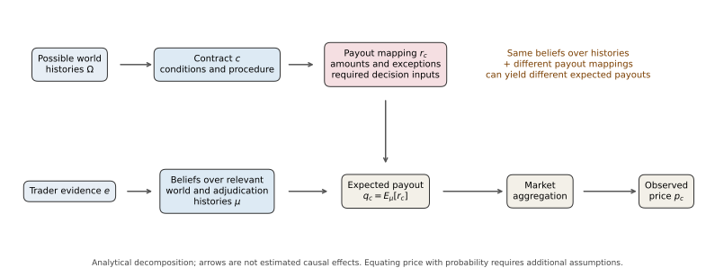

# Same Future, Different Claim: How Prediction Markets Define What Counts

Working manuscript; documentary audit with supplementary metadata analysis.

## Abstract

Prediction-market prices refer to contractual claims whose paying conditions can differ even when their questions concern the same public event. We examine how analysts can establish those conditions through a documentary audit of rules, event evidence and recorded outcomes. Hilton’s second-place primary result supports a zero settlement in a first-place contract and a full payout in an advancement contract. Khamenei’s departure contracts record 45 cents and YES, showing why a binary event or product label does not establish binary payout support. A suit-adjudication case links a reporting criterion to dated creator updates and a protocol-corroborated NO; successive minerals contracts illustrate different milestones with the same realized outcome. The findings organize comparability around qualifying conditions, payout amounts and remaining institutional inputs. They support an empirical diagnostic rather than estimates of prevalence or causal price effects.

## 1. Introduction

On June 2, 2026, Steve Hilton finished second in California’s gubernatorial primary and advanced to the general election. California’s nonpartisan primary sends the two candidates with the most votes to the next round, so finishing first and advancing are different achievements. Kalshi listed a contract on whether Hilton would finish first; Polymarket listed one on whether he would advance. The archived Kalshi record shows NO and a zero settlement, while the Polymarket record shows resolved YES, corresponding to a full unit payout. The certified election result and both records therefore describe a consistent outcome: Hilton qualified without taking first place. [Certified results](https://elections.cdn.sos.ca.gov/sov/2026-primary/sov/06-sov-summary.pdf) and the [contract audit](REPRESENTATION_CASEBOOK.md) identify the event and the claims separately.

The distinction matters when prices are used beyond the individual contract. If an analyst pooled these two prices as estimates of ‘Hilton’s primary prospects,’ the combined series would mix forecasts of first place with forecasts of advancing. Scoring both against a single outcome would likewise evaluate different targets as though they were the same forecast. Positions in the two contracts would not form an exact offset in the observed second-place outcome. These are consequences of their specified claims; the case does not show that traders or analysts actually made those mistakes.

Prediction-market prices can be interpreted as forecasts only in relation to what the positions pay for. The semantic step is easy to overlook because an event title is a convenient way to identify a market, whereas payment depends on more detailed rules. A contract can specify a different milestone, require a particular source to recognize it, or change the amount paid under an exception. Comparing prices as beliefs about one target therefore requires an account of those selections. Existing theories of contingent claims and semantic alignment supply the necessary concepts; the empirical question is how the relevant distinctions appear in linked records of real contracts and their outcomes.

The issue extends beyond visibly different achievements. In the Khamenei departure episode, one Kalshi contract recorded a settlement of 45 cents while a related Polymarket contract recorded YES. The Kalshi data described the product as binary, yet its death provision permitted a price-based allocation. In the Zelenskyy clothing case, the published criterion referred to credible reporting, and the question creator later issued a clarification about whether that consensus had been reached. These cases direct attention to both the amount promised and the institutional input needed to settle a claim.

We ask: **How can analysts establish what apparently comparable prediction-market contracts pay for, and what information is still required to determine settlement?** We address the question through a documentary audit linking identified contracts, available rule versions, event sources and recorded outcomes. Two cases contain observed payout differences; a single-contract adjudication case and a same-outcome milestone comparison help distinguish what the evidence can establish. A selected metadata portfolio provides descriptive context.

The contribution is a comparative empirical account of qualifying conditions, payout amounts and institutional determination. It makes the interpretation of each exhibit explicit and shows where additional source information is needed before a stronger claim can be made. This supports a focused audit of forecast comparability. It does not estimate how often these distinctions arise, whether traders understand them, or how they affect prices.

## 2. From public events to payable claims

### 2.1 From a public event to a forecast target

A prediction-market contract ties a payment to a specified condition. In the familiar winner-take-all design, a YES position receives one unit when the condition is met and zero otherwise. Its probabilistic interpretation depends on that payment rule and on assumptions about trading and preferences. [Wolfers and Zitzewitz (2004)](https://doi.org/10.1257/0895330041371321) distinguish contract designs that elicit probabilities, means and medians, and discuss the difficulty of specifying and adjudicating the relevant conditions. The forecast target is therefore the condition selected by the contract, including the associated payment rule.

Two contracts can refer to the same person and election while applying different predicates to that referent: finishing first, qualifying for a later round, being declared the winner, or taking office. Establishing a common referent is only the first step in comparing their targets. The rule also selects the achievement, time window, measurement convention, evidence source and exceptions. Throughout this paper, a rule-defined claim means the entitlement to payment produced by those conditions and the applicable resolution procedure.

This is a longstanding problem of representation and semantic interoperability. [Wand and Weber (1993)](https://doi.org/10.1111/j.1365-2575.1993.tb00127.x) assess representational clarity through mappings between modeling constructs and what they represent. [Goh et al. (1999)](https://doi.org/10.1145/314516.314520) show why information exchanged across systems requires the assumptions that determine its interpretation. In the present setting, a shared event label provides less information than a complete statement of the claim. The difference can also be substantive: first-place and advancement contracts offer distinct entitlements, so a change of units or a more consistent label cannot make them identical.

Recent prediction-market research makes these relationships explicit. [Gebele and Matthes (2026)](https://arxiv.org/html/2601.01706v1) model cross-platform event identity through resolution semantics and payoff regions. [Capponi, Gliozzo and Zhu (2026)](https://arxiv.org/html/2512.02436v3) develop a structured approach to discovering relations among contract texts and distinguish linguistic inference from relationships between settlements. These approaches make the object of comparison a contractual claim. The documentary audit developed here examines how qualifying conditions, fractional exceptions and authorized determination enter that object in particular observed cases.

### 2.2 Payoff divergence and the amount being forecast

**Payoff divergence** means that two contracts assign different normalized amounts to at least one explicitly described relevant scenario. The comparison holds the underlying facts fixed and states the information needed to apply each contract’s rules. A candidate who finishes second can receive zero under a first-place contract and one under an advancement contract. That scenario is a witness to non-equivalence: the two claims cannot be substituted for one another across the audited domain. Different wording alone is insufficient, and a witness to difference does not establish that either rule is ambiguous.

The amount payable requires separate attention. A clear event condition may coexist with a tie provision, a price-based allocation or another exception that pays a fraction of the nominal unit. The distinction is important because the probability of an occurrence and the expected amount received are different quantities. A model restricted to zero-or-one settlements remains appropriate within that restriction; the restriction must be checked against the contract being analyzed.

Write r_c(ω) for the amount paid by contract c in a fully specified relevant history ω, normalized so that a full payout is one. A history includes the event facts and any required reference prices or authority decisions. Under a common probability distribution μ, the expected payout is:

```text
q_c = E_μ[r_c]
q_A − q_B = E_μ[r_A − r_B]
```

If r_c can take only zero and one, q_c is the probability of the condition that pays one. With fractional amounts, q_c is an expected amount. For example, a 20% chance of receiving one dollar and a 30% chance of receiving 50 cents contribute 35 cents to expected payout. These probabilities are a synthetic illustration. A binary occurrence, such as departure from office, need not imply a binary settlement when the contract contains a fractional exception.

This distinction concerns what is valued. Observed price p_c also reflects trading conditions, including liquidity, spreads, fees and risk preferences. Different payout mappings can have different expected values under common beliefs; a separating scenario alone does not establish that their expected values differ. The scenario may have zero probability, or differences elsewhere may offset it. The expected-value identity clarifies the comparison without identifying an empirical price effect.

### 2.3 Written rules and institutional determination

**Written-rule determinacy** asks whether a specified version of the rules fixes one payout when the stated scenario information is supplied. The information held fixed must be explicit. For a candidate finishing second without a tie, rank and qualification rules may each yield a definite answer while yielding different payouts. In another contract, knowing the physical occurrence may leave a required reference price or authority decision unresolved. Analysts must distinguish an unknown future fact, a missing input and a genuinely underdetermined criterion. The absence of an explicit definition is not sufficient to prove that multiple payouts remain permissible.

A contract can specify who will decide a disputed question. Suppose the rule asks whether authentic images show a person wearing a suit and names a consensus of credible reporting as its resolution source. Knowing what the images depict does not itself establish what that reporting consensus will be. Once the relevant decision is supplied, the institution may record a unique payout. A need for later determination is therefore compatible with a definite eventual settlement. A stronger claim of institutional incompleteness would require showing that incompatible payouts remain permissible after all relevant procedural inputs are fixed.

Information-systems research explains why this institutional layer belongs in the analysis. [Recker et al. (2021)](https://doi.org/10.25300/MISQ/2021/16027) describe conceptual models as mediating between represented and digitally enacted realities. [Eriksson and Öhlund (2024)](https://doi.org/10.17705/1jais.00845) examine constitutive rules that establish institutional entities and rights. Applied to prediction markets, this perspective directs attention to the entitlement created by the contract and to the authority recognized to settle it. The platform’s rules govern the payment right attached to a position; the external election result remains common to the compared venues.

The temporal separation between occurrence and decision is also central to recent market research. [Wang (2026)](https://doi.org/10.1016/j.econlet.2026.113176) studies prices during disputes, when the underlying event has already occurred but the decision fixing the payoff is pending. [Nechepurenko (2026)](https://arxiv.org/html/2609.15368v1) distinguishes question rules, oracle adjudication and protocol settlement. Together these arguments show why an event date, a proposal, a recorded final outcome and a holder’s receipt are different observations. The present audit retains those distinctions when interpreting its evidence.

The analysis consequently asks three related questions: what qualifies under the claim, how much is payable, and which institutional inputs remain to be supplied? These questions describe overlapping dimensions of a contract. A rank contract can also contain fractional tie payouts; a reporting criterion can also contain precise image and deadline conditions. They provide an organizing scheme for the audit without asserting an exhaustive semantic taxonomy or treating every clause as an independently identified causal mechanism.

## 3. Audit design and evidence

### 3.1 Documentary units and source roles

Cases were selected purposively to examine contrasting contractual conditions and evidence types. The main units are two cross-platform contract pairs with different recorded payouts, one pair of successive contracts with the same recorded outcome, and one single-contract adjudication episode. We keep three source roles distinct: contract descriptions specify available rules; independent event sources establish the public occurrence; platform or protocol records establish the recorded outcome. A documented appearance, for example, is evidence that an event occurred, while a creator clarification is evidence about the resolution criterion being applied.

For each exhibit, the audit retains stable identifiers, the supplied question and rule text, source versions, the scenario information used, and recorded or hypothetical payouts. Fingerprints bind assertions to those inputs; altered inputs withhold dependent claims until re-audit. A matching fingerprint establishes consistency with the audited files, rather than exhaustive governing-rule coverage. Series-level specifications and all historical clarifications are not reconstructed. The presidential death/interruption witness is consequently withheld because a current linked specification contains additional exceptions whose historical applicability is unverified. Remaining hypothetical scenarios are conditional applications of their stated archived question rules.

The case inventory contains 9 exhibits: four observed exhibits and 5 proposed hypothetical scenarios. One presidential witness is withheld pending governing-version evidence. Exhibit counts refer to evidential displays, including shared contracts, rather than independent events or identified mechanisms.

The suit extension is deliberately narrow. A public Polygon read verifies the adapter/question/condition linkage, the stored question text, the creator’s update list and the condition’s payout numerators at a pinned block. The stored updates supply two dated observations, including a dispute acknowledgment before the June 24 appearance. A historical-log query returned HTTP 403, so individual proposal rounds and the original final-resolution transaction were not reconstructed. Current protocol state, stored update timestamps, API closure time and holder receipts retain separate evidence roles. The [source bundle and acquisition record](paper-revision/2026-10-15-01/P2_OUTCOME.md) document those checks.

### 3.2 Metadata context and supplementary analysis

The historical portfolio combines high-volume Kalshi series with high-volume closed Polymarket markets. Its selection is purposive, and the historical Polymarket sports filter incorrectly excluded some non-sports records. Original request times and the rejected/overflow sample are unavailable. September 10 is a legacy label; three retained source updates are dated September 11. These limitations preclude a population or platform-quality ranking. Named cases recovered separately from the metadata portfolio are not treated as a random subsample of it.

The automated text components record authority, time, definition/threshold, edge-clause and discretion-term cues. Their equal-weight mean is an exploratory specificity index, not a validated measure of whether a rule determines a payout in a scenario. Each component is a weighted cue score; the discretion component is not a no-flag frequency. The [measurement note](MEASUREMENT_NOTE.md), [component profiles](tables/analysis-platform-profiles.csv) and [data atlas](descriptions-data.html) provide the descriptive context. The case classifications are not inferred from these scores.

Metadata time fields are also treated as proxies. In the named Khamenei Polymarket record, endDate is 27 hours 59 minutes earlier than the explicit Eastern Time deadline; in the two minerals records the difference is 15 hours 59 minutes. The operative dates and metadata values are retained separately in the [data-source note](../DATA_SOURCES.md). We do not interpret these metadata fields as proof of a complete semantic window or synchronized price observations.

Activity and terminal-error analyses remain supplementary. The preferred activity specification adjusts for metadata exposure and opening cohorts, uses within-platform standardization and platform-qualified family clusters, and compares HC3 uncertainty on the same rows and formula. Volume selection, retrospective rules and incomplete exposure prevent a causal interpretation. No synchronized-price or common-horizon forecast-accuracy test is established by the retained panel.

The retained metadata portfolio contains 19,500 contracts: Kalshi: 12,251; Polymarket: 7,249. The case audit and this selected portfolio answer different questions.

## 4. Findings

### 4.1 What qualifies: achievements and milestones

The first comparison concerns the event condition rewarded by the claim. A primary election can establish both a ranking and eligibility for the next round. An agreement can pass through an announcement and a later signature. The observed record distinguishes these conditions without implying that they must produce different settlements on every occasion.

**Steve Hilton: first place versus advancing in the California primary.**

Steve Hilton finished second in the June 2, 2026 California primary and advanced to the general election. Certified results place Becerra first (28.0%), Hilton second (24.6%) and Steyer third (22.8%).

The Kalshi claim rewarded first place and allowed a proportional payout for exact ties. The Polymarket claim rewarded advancement, for which either of the top two positions qualified. Hilton's untied second place therefore produced NO and a recorded zero settlement on Kalshi, alongside resolved YES and a full unit payout on Polymarket. The common election result supports both outcomes because the contracts select different achievements.

Both records are in the September-labelled sample and match the preserved October follow-up on operative fields. They have different cutoff/fallback conditions; the archived tie clause permits fractional amounts. Linked governing specifications are not certified historical editions. This realized contrast establishes no price error or trader misunderstanding.

Source records: [Kalshi KXCAGOVPRIMARY1ST-26JUN02-1ST-SHIL](https://kalshi.com/markets/kxcagovprimary1st-26jun02-1st-shil); [Polymarket 825460](https://polymarket.com/event/will-steve-hilton-get-the-first-or-second-most-votes-in-the-2026-california-governor-primary-election); [event source](https://elections.cdn.sos.ca.gov/sov/2026-primary/sov/06-sov-summary.pdf).

**U.S.–Ukraine minerals agreement: two YES resolutions across milestones.**

During the 2025 U.S.–Ukraine minerals negotiations, one Polymarket contract asked whether Ukraine would agree to a deal before April; another required a signed deal before May. The March agreement contract records YES and March 25 closure. The U.S. Treasury and Ukrainian ministry record an April 30, 2025 signing; the later signed-deal contract records YES and May 4 closure.

The earlier contract accepted a public announcement of an agreement by March 31. The later contract required signing or formal adoption by April 30 and excluded an announcement alone. These are successive milestones with different windows. The recorded YES outcomes show that such differences need not produce a realized split: an announcement can satisfy the earlier condition, and a subsequent signature can satisfy the later one.

Different windows, rare-earth/mineral scope and evidence authorities prevent a controlled milestone comparison. The YES/YES chronology does not instantiate the supplementary hypothetical YES/NO witness and establishes no manipulation or erroneous March outcome.

Source records: [Polymarket 521607](https://polymarket.com/event/ukraine-agrees-to-give-trump-rare-earth-metals-before-april); [Polymarket 532897](https://polymarket.com/event/trump-x-ukraine-mineral-deal-signed-before-may); [event source](https://home.treasury.gov/news/press-releases/sb0126); [event source](https://me.gov.ua/News/Detail/91af98f8-9ae6-49ba-99ae-adb847fe493a?lang=en-GB).

### 4.2 How much pays: fractional exceptions

A second distinction concerns the amount attached to a qualifying occurrence. Even after identifying the relevant departure, a price-referenced exception can change the settlement amount. This question overlaps with the first: the full rule must specify both which occurrence counts and which payment rule applies.

**Ali Khamenei departure: price-based death allocation versus YES.**

Two markets concerned Ali Khamenei's departure as Iran's Supreme Leader. Following the February 28, 2026 attack, contemporaneous March 1 reporting recorded Iranian state media confirming Khamenei's death. The compared contracts recorded scalar 45-cent and resolved-YES settlements.

The Kalshi description covered departure before July 1, 2026 and qualifying announcements, but treated a death-only departure through a pre-death price or a committee's fair allocation. Its record reports a scalar settlement of $0.45. The Polymarket rule covered loss of the position or ability to perform its duties by June 30, 11:59 PM ET; its record shows resolved YES, corresponding to $1. Identifying the departure answers the event question, while valuing the Kalshi claim also requires the allocation rule and its reference inputs.

The deadlines and exceptions differ, so this is not a controlled clause effect. The API description includes announcement, ordinary departure, price-based death allocation and binding committee discretion. The exact reference-price selection was not audited. Reported reimbursements can make account receipts differ from contract settlement; original linked social posts were inaccessible. No binary-event restriction applies.

Source records: [Kalshi KXKHAMENEIOUT-AKHA-26JUL01](https://kalshi.com/markets/kxkhameneiout-akha-26jul01); [Polymarket 661699](https://polymarket.com/event/khamenei-out-as-supreme-leader-of-iran-by-june-30-747); [event source](https://apnews.com/article/5b13b69b708c4ed38e8f95f5fb41a597); [event source](https://cointelegraph.com/news/kalshi-founder-khamenei-market-carveout).

### 4.3 What remains for institutional determination

The final exhibit concerns a single contract with a specified reporting source. It separates the public appearance, the creator’s application of the reporting criterion, and the recorded institutional outcome. The added records help establish that sequence without identifying the rationale of every challenge.

**Zelenskyy's clothing: reporting criterion and recorded adjudication.**

The Ukrainian presidency documented a June 24, 2025 appearance by President Volodymyr Zelenskyy in the Netherlands, with photographs. A Polymarket contract asked whether authentic images showed him wearing a suit during May 22–June 30. The question creator had already acknowledged a dispute on May 29 and stated on July 1 that credible reporting had not confirmed a qualifying suit appearance. The market record reports NO, corroborated by the linked protocol read.

The contract required authentic images or video taken and released within the stated window and named a consensus of credible reporting as its resolution source. The creator's July 1 update addressed whether that reporting criterion had been met. The recorded outcome is NO, corresponding to a zero payout, and the pinned protocol state corroborates it. The dated updates make the institutional application observable: the May 29 dispute acknowledgment preceded the June 24 appearance, while the July 1 clarification followed the window's close. The photograph alone cannot explain the whole dispute history.

The appearance source does not independently classify the clothing. Question/condition hashes, creator updates and current NO payout are verified at a pinned block. Historical log access returned HTTP 403; no complete proposal/finality chronology or reason for each challenge was recovered. The stored request timestamp is not initialization. No pairwise divergence, institutional incompleteness or holder receipts are inferred.

Source records: [Polymarket 546814](https://polymarket.com/event/will-zelenskyy-wear-a-suit-before-july); [event source](https://www.president.gov.ua/en/news/vidbulasya-audiyenciya-prezidenta-ukrayini-v-korolya-niderla-98637).

### 4.4 Cross-case synthesis

| Audit dimension | Unit and information held fixed | Observation | Supported inference |
|---|---|---|---|
| Qualifying achievement | Hilton pair; certified primary rank | NO/$0 and YES/$1 | Shared election facts support different claim outcomes. |
| Milestone and time window | Successive minerals contracts; dated closure and signing records | YES/YES | Distinct conditions can coincide in the realized outcomes. |
| Payout amount and exception | Khamenei pair; departure episode and recorded allocations | $0.45 and YES/$1 | Binary product metadata do not establish binary payout support. |
| Authorized determination | One suit contract; question, creator updates and pinned protocol read | Reporting clarification and corroborated NO | The named reporting criterion has a documented institutional application; individual dispute causes remain unresolved. |

The dimensions overlap. The rank cases also contain fractional tie clauses, while the suit question contains time and authenticity conditions. A hypothetical rounding witness addresses how a measurement enters a category; it is not another observed fractional settlement. The full [casebook](REPRESENTATION_CASEBOOK.md) and [case matrix](tables/representation-case-matrix.csv) preserve the source versions and surviving hypothetical scenarios. The presidential interruption witness is withheld. Metadata text scores and activity estimates remain in the [supplementary materials](SUPPLEMENTARY_ANALYSIS.md).

## 5. Discussion and conclusion

### 5.1 Forecast targets and the task of comparison

Hilton’s second place shows why a common event record is insufficient to identify a common forecast target. The two recorded settlements are consistent with the election result because the claims reward different achievements. This applies the established role of contract specification to a concrete comparison problem. In the terms of [Wang and Strong (1996)](https://doi.org/10.1080/07421222.1996.11518099), fitness for a data consumer’s task involves interpretation and context as well as accuracy. A correctly recorded price can be unsuitable for a pooled forecast if the pooling operation silently changes the target.

The implication depends on the task. Forecast pooling and scoring against one target require a justified correspondence between the claims and that target. Exact offsetting requires an appropriate relation between payouts across the relevant states. Broader hedging can use related claims without exact equivalence, and analysts can meaningfully compare the prices of different achievements. The audit therefore specifies the relation needed for a proposed use. It does not prohibit comparison whenever contracts differ.

This task-specific interpretation connects the evidence to semantic-interoperability research. [Goh et al. (1999)](https://doi.org/10.1145/314516.314520) retain contextual assumptions when combining data. Prediction-market comparison additionally encounters deliberate differences in the entitlements being traded. The Hilton pair is not an error to eliminate by making the labels uniform. Preserving the difference tells an analyst which forecast or exposure each position provides.

### 5.2 Payout support and the boundary of a binary abstraction

Khamenei’s 45-cent settlement adds an issue that identifying the departure condition alone would miss. The recorded product-type label was binary, while the archived rule allowed a price-referenced allocation and the settlement was fractional. The relevant forecast quantity therefore depends on the exception’s amount and inputs. This is a concrete check on the applicability of a binary payoff model. It complements the explicitly binary scope of [Gebele and Matthes (2026)](https://arxiv.org/html/2601.01706v1) and the distinction between textual and settlement relations developed by [Capponi et al. (2026)](https://arxiv.org/html/2512.02436v3).

The evidence supports auditing payout amounts alongside event conditions. It does not identify the counterfactual price of a contract without the exception, the probability traders assigned to the death scenario, or the reference-price choice that generated the allocation. Reported reimbursements further separate contract settlement from an individual account’s receipts. The expected-payout formulation accommodates those amounts, while the observed case supplies no new valuation theorem.

### 5.3 Institutional determination and the scope of the evidence

The suit case makes the role of an authorized determination more concrete. The question creator’s July 1 update addressed whether the named credible-reporting criterion had been satisfied. Its May 29 acknowledgment also establishes that the dispute history began before the June 24 photograph used to introduce the appearance. The observations support a documented relation among the criterion, creator communication and recorded outcome. They leave the reasons for the individual challenges unresolved.

This distinction is consistent with [Eriksson and Öhlund’s (2024)](https://doi.org/10.17705/1jais.00845) account of rules governing institutional entities and rights, and with [Wang’s (2026)](https://doi.org/10.1016/j.econlet.2026.113176) separation of event occurrence from pending adjudication. [Nechepurenko (2026)](https://arxiv.org/html/2609.15368v1) provides the further distinction between adjudication stages and protocol settlement. Here, the added protocol read corroborates the recorded NO, but a complete historical trace is unavailable. A missing garment-level definition and a contested process do not prove that the institution lacked a determinate eventual outcome.

Interfaces and research datasets could retain qualifying conditions, possible payout amounts and authoritative updates alongside prices. These are design proposals to be evaluated, rather than tested improvements in comprehension. A small prospective comparison could assess whether the same audit distinctions remain useful before outcomes are known. A reusable classification measure would require independent applications of complete rules to specified scenarios and explicit treatment of disagreement.

### 5.4 Limitations and conclusion

The exhibits demonstrate particular distinctions and cannot estimate their prevalence or economic magnitude. Their purposive selection, unequal deadlines and exceptions prevent isolating clause effects. Some rules are retrospective snapshots, historical governing versions remain incomplete, and the metadata portfolios have unresolved acquisition and selection gaps. The lexical measures describe text without validating semantic determinacy. Current protocol corroboration does not recover every historical stage or a holder’s cash flow. These limits rule out a platform ranking, an inference of manipulation and a general causal price or comprehension claim.

The cases show why contract comparison requires attention to the achievement that qualifies, the amount payable and the institutional inputs needed to settle the claim. The audit keeps those questions distinct while tracing how they meet in observed records. Before using a market price as a forecast, specify the claim whose expected payout it represents under the relevant pricing assumptions.



*Figure 1. Analytical decomposition of the contract comparison. Qualifying conditions, payout amounts and required institutional decisions specify the claim. Expected payout and observed market price have separate roles; the arrows are not estimated causal effects.*

## References

- Capponi, A., Gliozzo, A., & Zhu, B. (2026). Agentic AI for Clustering, Relationship Discovery, and Semantic Trading in Prediction Markets. arXiv:2512.02436v3, 29 September; preprint, first version 2025. [Version](https://arxiv.org/html/2512.02436v3).
- Eriksson, O., & Öhlund, S.-E. (2024). Digital Institutionalization: The Case of E-Prescribing. *Journal of the Association for Information Systems, 25*(3), 569–593. [DOI](https://doi.org/10.17705/1jais.00845).
- Gebele, J., & Matthes, F. (2026). Semantic Non-Fungibility and Violations of the Law of One Price in Prediction Markets. arXiv:2601.01706v1, 5 January; preprint. [Version](https://arxiv.org/html/2601.01706v1).
- Goh, C. H., Bressan, S., Madnick, S., & Siegel, M. (1999). Context Interchange: New Features and Formalisms for the Intelligent Integration of Information. *ACM Transactions on Information Systems, 17*(3), 270–293. [DOI](https://doi.org/10.1145/314516.314520).
- Nechepurenko, M. (2026). Resolution Is Not Settlement, Part I: Oracle Adjudication and Semantic Governance on Polymarket. arXiv:2609.15368v1, 14 September; preprint. [Version](https://arxiv.org/html/2609.15368v1).
- Recker, J., Lukyanenko, R., Jabbari Sabegh, M. A., Samuel, B. M., & Castellanos, A. (2021). From Representation to Mediation: A New Agenda for Conceptual Modeling Research in a Digital World. *MIS Quarterly, 45*(1), 269–300. [DOI](https://doi.org/10.25300/MISQ/2021/16027).
- Wand, Y., & Weber, R. (1993). On the ontological expressiveness of information systems analysis and design grammars. *Information Systems Journal, 3*(4), 217–237. [DOI](https://doi.org/10.1111/j.1365-2575.1993.tb00127.x).
- Wang, G. (2026). Do prediction markets price events or adjudication? Evidence from the disputed Polymarket markets. *Economics Letters, 268*, 113176. [DOI](https://doi.org/10.1016/j.econlet.2026.113176).
- Wang, R. Y., & Strong, D. M. (1996). Beyond Accuracy: What Data Quality Means to Data Consumers. *Journal of Management Information Systems, 12*(4), 5–33. [DOI](https://doi.org/10.1080/07421222.1996.11518099).
- Wolfers, J., & Zitzewitz, E. (2004). Prediction Markets. *Journal of Economic Perspectives, 18*(2), 107–126. [DOI](https://doi.org/10.1257/0895330041371321).
